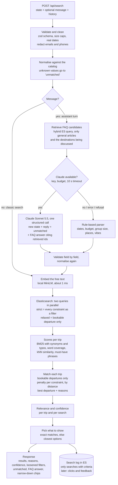
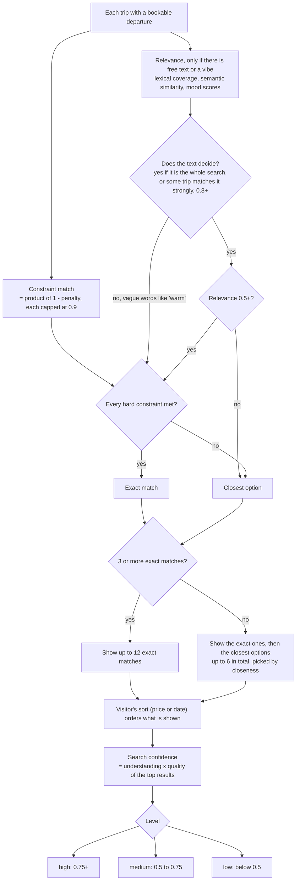

# How the search works

One endpoint, `POST /api/search`, serves both the classic search bar and the assistant. The page sends its **current search state** (text, dates, filters). It also sends the visitor's **message** when the assistant is used, plus the last few chat turns. The answer is the new state, the results, a confidence score and the reasons behind it. Code: `src/server/search/`, one file per step below.

## One turn, end to end

## The steps

1. **Validate and clean** (`state.ts`). Every input is checked: field sizes, real calendar dates (2027-02-29 is rejected), and known values only. Emails and phone numbers are masked in the message, chat history and free text before anything reaches Claude or the log. Values the catalog doesn't know (e.g. "Antarctica") are listed as **unmatched**, never silently dropped.
2. **Understand the message** (`interpret.ts`, assistant turns only).
   - **What Claude returns:** a single Claude call turns the message into the complete new search state, a one-line reply and the requests it can't map. It also answers FAQ questions, using only the help-centre articles retrieved for that message, and the cited ids are checked.
   - **What Claude doesn't do:** rank, filter or score.
   - **Fallback:** if Claude is unavailable (no key, timeout, refusal, invalid output, daily spend cap), the rule-based parser (`rules.ts`) answers instead, and confidence is lowered.
3. **Retrieve** (`retrieve.ts`). Two Elasticsearch queries run at the same time:
   - *strict*: every constraint is a filter, so exact matches are never missed;
   - *relaxed*: only "has a bookable departure", the pool for the closest options.

   Each query scores the free text in three ways:
   - BM25 with travel synonyms and typo tolerance;
   - which of the visitor's words the trip really mentions, with no fuzziness, so "skiing" doesn't count "sky";
   - embedding similarity.

   A must-have ("cooking class") has to appear as a phrase.
4. **Match** (`match.ts`, pure functions).
   - **Bookability:** only bookable departures count (open status, seats left, future date). Sold-out departures are never shown. This is enforced in the query and checked again here.
   - **Penalties:** each constraint gets a penalty that grows with distance. Three days late is closer than three weeks; 10% over budget is closer than 50%.
   - **Exact match:** a trip with zero penalty on every hard constraint. The age band is only a preference, as the FAQ says it's a guide.
   - **Reasons:** every check produces a ✓ or ✗ reason in plain words.
5. **Score** (`confidence.ts`). See below.
6. **Respond and log** (`run.ts`). Besides the results, the response carries:
   - the filters that were loosened ("budget — up to 22% over");
   - the unmatched requests;
   - one "good to know" FAQ per destination;
   - "narrow it down" chips for broad searches (`suggest.ts`).

   Searches with criteria are logged with their state, results, confidence, latency, tokens, cost and version. Clicks and votes are added to the same log entry later.

## Which trips are shown, and how sure we are

- **Trip confidence** = constraint match × relevance factor. The relevance factor counts fully when the text decides the search, and lightly when it is only a nudge. A *closest option* is capped at 0.7, so its badge never reads "high".
- **Understanding** = 1 for a classic search, lower for the rules fallback or when Claude reports ambiguity, and ×0.8 per unmatched request.
- **Search confidence** looks at the top exact matches when there are any, otherwise at the top closest options. With no exact match, it can't be "high". If *everything* asked was unservable (e.g. only "Antarctica"), it is low and the banner says so.
- **No criteria at all** (the landing page, "Start over"): nothing is scored, no "% match" is shown, and the search isn't logged.

## Before any search: data preparation

On first boot `seed.ts` loads `samples/`, backfills the 15 missing continents, and shifts every departure forward by the days elapsed since the export, so the demo stays in the future. On later boots, departures are moved forward in place, which keeps backoffice edits.

## Where to look

| Question | File |
|---|---|
| What can be searched, and how is input validated? | `src/shared/types.ts`, `search/state.ts` |
| What does Claude see and return? | `search/interpret.ts` (prompt and schema) |
| What does the fallback understand? | `search/rules.ts` |
| Which Elasticsearch queries run? | `search/retrieve.ts`, `es.ts` (mappings, synonyms) |
| Why is a trip ✓ or ✗, exact or closest? | `search/match.ts` |
| How are relevance and confidence computed? | `search/confidence.ts` |
| How do we know it works? | `eval/` (`npm run eval`), `*.test.ts` |
